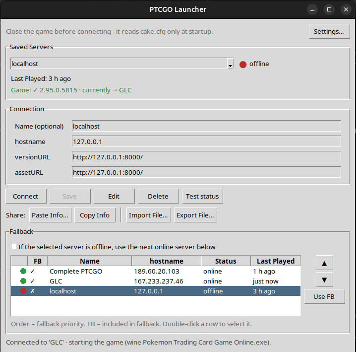

<p align="center"></p>

# Libre's TCG Online Launcher

A small server picker for the **Pokémon Trading Card Game Online** client (version **2.95.0.5815**).
Save the private servers you play on, see which ones are online, and switch between them with one click:
the launcher rewrites the connection lines of the game's `cake.cfg` and starts the game for you.



<sub>Once it finds your game, the window is titled "PTCGO Launcher" and uses the game's own icon.</sub>

> Fan-made project, not affiliated with The Pokémon Company, Nintendo, Creatures or GAME FREAK.
> It does **not** include the game. You need your own copy of the client. See [NOTICE.md](NOTICE.md).

## Features

- **Saved servers** with live status: 🟢 online · 🟠 starting · 🟡 partial · 🟣 not a PTCGO server · 🔴 offline
- **Last Played** for each server
- **Fallback**: if the selected server is offline, connect to the next online one (order and members are configurable)
- **Automatic server name** (leave *Name* empty when saving and it is read from the server)
- **Share servers** as text (*Copy Info* / *Paste Info*) or as a `.cfg` file (*Import File* / *Export File*)
- **Settings**: finds the game automatically (or browse to it), with a read-only check of `cake.cfg`.
  On Linux you can choose the Wine build, prefix and environment variables.
- **Safe**: the original `cake.cfg` is backed up once (`cake.cfg.launcher-backup`) and can be restored from Settings

## Requirements

- **Python 3.10 or newer** with Tk (standard library only, no extra packages)
- **Pokémon TCG Online 2.95.0.5815**, installed:
  - **Windows**: normal installation
  - **Linux**: in a Wine prefix (plain Wine or Lutris)
  - **macOS**: the `.app` (untested)

## How to run

| System | Setup | Run |
|---|---|---|
| **Windows** | Install Python from [python.org](https://www.python.org/downloads/windows/) and tick **"Add python.exe to PATH"** | Double-click `launcher_proto.py`, or `py launcher_proto.py` |
| **Linux** | Python is usually installed. If Tk is missing: `sudo apt install python3-tk` | `python3 launcher_proto.py` |
| **macOS** | Use the Python from [python.org](https://www.python.org/downloads/macos/) (the system Python's Tk is outdated) | `python3 launcher_proto.py` |

Keep `logo.png` next to `launcher_proto.py`.

## Usage

1. Open the launcher. It looks for the game automatically. If it isn't found, open **Settings…** and point it to the game
   folder, its `_Data` folder, the `.exe` or `cake.cfg`.
2. Add a server: fill in **hostname** (the URLs are suggested as `http://<host>:8000/`) and click **Save**,
   or use **Paste Info…** with the three lines a server owner gives you:
   ```
   hostname=203.0.113.10
   versionURL=http://203.0.113.10:8000/
   assetURL=http://203.0.113.10:8000/
   ```
3. Select a server and click **Connect**. Close the game first: it reads `cake.cfg` only at startup.

Each server has its own accounts. On most private servers the account is created the first time you log in.

## Where things are stored

| | Location |
|---|---|
| Servers and settings | Windows `%APPDATA%\ptcgo-launcher` · macOS `~/Library/Application Support/ptcgo-launcher` · Linux `~/.config/ptcgo-launcher` |
| Backup of the original `cake.cfg` | next to `cake.cfg`, as `cake.cfg.launcher-backup` |

Once the game is found, the launcher shows the game's own icon, read from your installation and kept only on your computer.

## License

[GNU GPL v3.0 or later](LICENSE) © 2026 LibreSoldier. The logo text uses Orbitron (SIL Open Font License).
